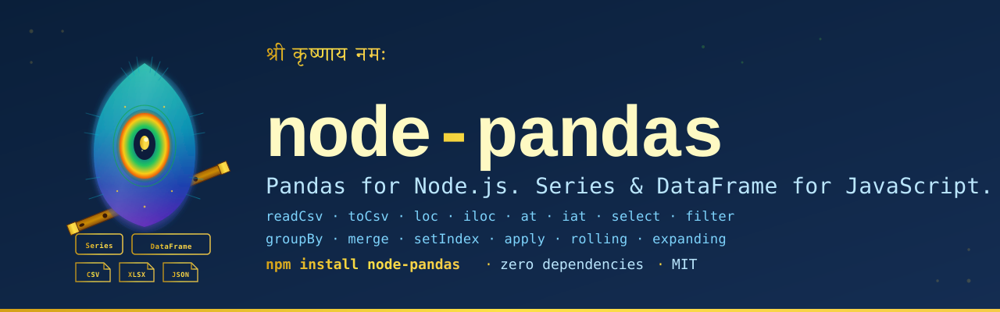
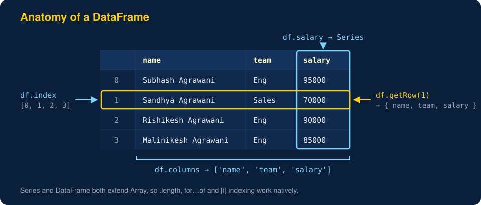
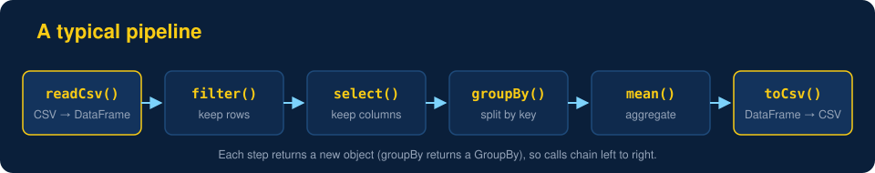
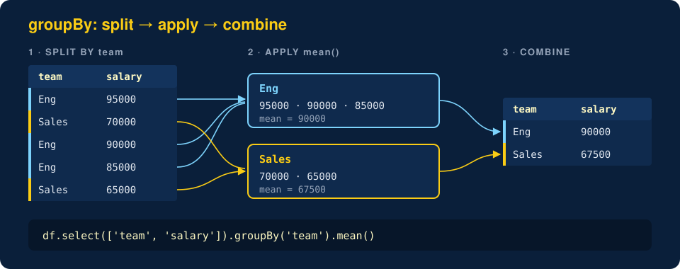
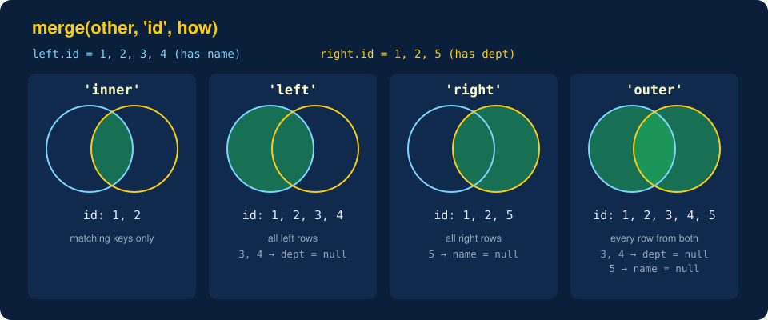

<p align="center">
  
</p>

<h1 align="center">node-pandas</h1>

<p align="center">
  <strong>pandas-style <code>Series</code> and <code>DataFrame</code> for Node.js, with zero runtime dependencies.</strong>
</p>

<p align="center">
  <a href="https://www.npmjs.com/package/node-pandas"></a>
  <a href="https://www.npmjs.com/package/node-pandas"></a>
  <a href="https://packagephobia.com/result?p=node-pandas"></a>
  
  <a href="https://github.com/hygull/node-pandas/blob/master/LICENSE"></a>
  <a href="https://github.com/hygull/node-pandas"></a>
</p>

<p align="center">
  <a href="#quick-start">Quick start</a> ·
  <a href="#a-quick-tour">Tour</a> ·
  <a href="#coming-from-pandas">Coming from pandas</a> ·
  <a href="https://github.com/hygull/node-pandas/blob/master/docs/api/series.md">Series API</a> ·
  <a href="https://github.com/hygull/node-pandas/blob/master/docs/api/dataframe.md">DataFrame API</a> ·
  <a href="https://github.com/hygull/node-pandas/blob/master/CHANGELOG.md">Changelog</a>
</p>

---

If you know Python's [pandas](https://pandas.pydata.org/), you already know most of node-pandas: load a CSV, filter rows, group and aggregate, join tables, and run rolling-window statistics, all from plain JavaScript.

## Quick start

```bash
npm install node-pandas
```

```javascript
const pd = require("node-pandas")

const df = pd.DataFrame(
  [
    ['Subhash Agrawani', 'Eng', 95000],
    ['Sandhya Agrawani', 'Sales', 70000],
    ['Rishikesh Agrawani', 'Eng', 90000],
    ['Malinikesh Agrawani', 'Eng', 85000],
    ['Hemkesh Agrawani', 'Sales', 65000]
  ],
  ['name', 'team', 'salary']
)

df.select(['team', 'salary']).groupBy('team').mean().show
// ┌─────────┬─────────┬────────┐
// │ (index) │  team   │ salary │
// ├─────────┼─────────┼────────┤
// │    0    │  'Eng'  │ 90000  │
// │    1    │ 'Sales' │ 67500  │
// └─────────┴─────────┴────────┘
```

Also available through `yarn add node-pandas` and `pnpm add node-pandas`. Requires Node.js 14 or later.

## Why node-pandas?

| | |
| --- | --- |
| **Zero dependencies** | Nothing but the library itself lands in `node_modules`. |
| **Familiar API** | Method names and behaviour follow pandas, so existing knowledge transfers. |
| **Native arrays** | `Series` and `DataFrame` extend `Array`: `.length`, `[i]` and `for...of` just work. |
| **Batteries included** | `groupBy`, `merge` (all four join types), `concat`, `rolling`/`expanding` windows, string accessor, label and position indexing, and CSV I/O. |
| **Immutable by default** | Transformations return a new object and keep the original `index` and `name`. |

## Core concepts

A **DataFrame** is a table with an `index` (row labels) and `columns`. Reading a column by name returns a **Series**, a one-dimensional labelled array. Reading a row returns a plain object.

<p align="center">
  
</p>

```javascript
const pd = require("node-pandas")

const df = pd.DataFrame(
  [['Subhash Agrawani', 'Eng', 95000], ['Sandhya Agrawani', 'Sales', 70000]],
  ['name', 'team', 'salary']
)

console.log(df.columns)     // [ 'name', 'team', 'salary' ]
console.log(df.salary)      // Series(2) [ 95000, 70000 ]
console.log(df.salary.mean()) // 82500
console.log(df.getRow(1))   // { name: 'Sandhya Agrawani', team: 'Sales', salary: 70000 }
```

## A quick tour

Most work in node-pandas is a short chain of calls, with each step returning a new object:

<p align="center">
  
</p>

### 1. Load, filter and select

Given [`devs.csv`](https://github.com/hygull/node-pandas/blob/master/docs/csvs/devs.csv):

```javascript
const pd = require("node-pandas")

const devs = pd.readCsv("./docs/csvs/devs.csv")

devs
  .filter(row => row.DevId > 5000)
  .select(['fullName', 'Language'])
  .show
// ┌─────────┬──────────────────────┬──────────────┐
// │ (index) │       fullName       │   Language   │
// ├─────────┼──────────────────────┼──────────────┤
// │    0    │    'Jeff Thomas'     │    'Java'    │
// │    1    │ 'Rishikesh Agrawani' │   'Python'   │
// │    2    │   'Briella Brown'    │ 'JavaScript' │
// └─────────┴──────────────────────┴──────────────┘
```

`readCsv` turns numeric fields into numbers and skips blank lines. Write any DataFrame back out with `df.toCsv('./out.csv')`.

### 2. Group and aggregate

<p align="center">
  
</p>

```javascript
const pd = require("node-pandas")

const df = pd.DataFrame(
  [['Eng', 95000], ['Sales', 70000], ['Eng', 90000], ['Eng', 85000], ['Sales', 65000]],
  ['team', 'salary']
)

df.groupBy('team').sum().show
// ┌─────────┬─────────┬────────┐
// │ (index) │  team   │ salary │
// ├─────────┼─────────┼────────┤
// │    0    │  'Eng'  │ 270000 │
// │    1    │ 'Sales' │ 135000 │
// └─────────┴─────────┴────────┘
df.groupBy('team').count().show
// ┌─────────┬─────────┬───────┐
// │ (index) │  team   │ count │
// ├─────────┼─────────┼───────┤
// │    0    │  'Eng'  │   3   │
// │    1    │ 'Sales' │   2   │
// └─────────┴─────────┴───────┘
```

`mean`, `sum`, `min`, `max` and `std` aggregate every numeric column, so `select()` the columns you need first.

### 3. Join tables

<p align="center">
  
</p>

```javascript
const pd = require("node-pandas")

const people = pd.DataFrame(
  [[1, 'Rishikesh Agrawani'], [2, 'Hemkesh Agrawani'], [3, 'Malinikesh Agrawani'], [4, 'Sandhya Agrawani']],
  ['id', 'name']
)
const depts = pd.DataFrame(
  [[1, 'Engineering'], [2, 'Sales'], [5, 'Operations']],
  ['id', 'dept']
)

people.merge(depts, 'id', 'outer').show
// ┌─────────┬────┬───────────────────────┬───────────────┐
// │ (index) │ id │         name          │     dept      │
// ├─────────┼────┼───────────────────────┼───────────────┤
// │    0    │ 1  │ 'Rishikesh Agrawani'  │ 'Engineering' │
// │    1    │ 2  │  'Hemkesh Agrawani'   │    'Sales'    │
// │    2    │ 3  │ 'Malinikesh Agrawani' │     null      │
// │    3    │ 4  │  'Sandhya Agrawani'   │     null      │
// │    4    │ 5  │         null          │ 'Operations'  │
// └─────────┴────┴───────────────────────┴───────────────┘
```

Swap `'outer'` for `'inner'`, `'left'` or `'right'`. To stack DataFrames instead, use `pd.DataFrame.concat([a, b], 0)` for rows or `1` for columns.

### 4. Series: windows, cumulative stats and strings

```javascript
const pd = require("node-pandas")

const price = pd.Series([10, 12, 11, 15, 18, 21], { name: 'price' })

console.log(price.rolling(3).max()) // Series(6) [ null, null, 12, 15, 18, 21 ]
console.log(price.expanding().mean().iloc.get(5)) // 14.5
console.log(price.cumsum()) // Series(6) [ 10, 22, 33, 48, 66, 87 ]
console.log(price.gt(14))   // Series(6) [ false, false, false, true, true, true ]

const names = pd.Series(['  alice ', 'BOB', null])
console.log(names.str.strip().str.upper()) // Series(3) [ 'ALICE', 'BOB', null ]
```

Missing values (`null`, `undefined`, `NaN`) are kept in place. Numeric methods skip them, and `fillna`, `dropna`, `isna` and `notna` handle them explicitly.

### 5. Index by label or position

```javascript
const pd = require("node-pandas")

const df = pd.DataFrame(
  [['Subhash Agrawani', 95000], ['Sandhya Agrawani', 70000]],
  ['name', 'salary']
).setIndex('name')

console.log(df.at.get('Sandhya Agrawani', 'salary')) // 70000
console.log(df.iat.get(0, 0)) // 95000

const s = pd.Series([10, 20, 30], { index: ['a', 'b', 'c'] })
console.log(s.loc.get(['a', 'c'])) // Series(2) [ 10, 30 ]
console.log(s.iloc.get(1))  // 20
```

## Coming from pandas

| pandas (Python) | node-pandas (JavaScript) |
| --- | --- |
| `pd.Series([1, 2, 3])` | `pd.Series([1, 2, 3])` |
| `pd.DataFrame(rows, columns=cols)` | `pd.DataFrame(rows, cols)` |
| `pd.read_csv('f.csv')` | `pd.readCsv('f.csv')` |
| `df.to_csv('f.csv')` | `df.toCsv('f.csv')` |
| `df['salary']` / `df.salary` | `df.salary` |
| `df[['name', 'salary']]` | `df.select(['name', 'salary'])` |
| `df[df.age >= 18]` | `df.filter(row => row.age >= 18)` |
| `df.groupby('team').mean()` | `df.groupBy('team').mean()` |
| `df.merge(other, on='id', how='left')` | `df.merge(other, 'id', 'left')` |
| `pd.concat([a, b])` | `pd.DataFrame.concat([a, b], 0)` |
| `df.set_index('id')` / `df.reset_index()` | `df.setIndex('id')` / `df.resetIndex()` |
| `df.apply(fn, axis=1)` | `df.apply(fn, { axis: 1 })` |
| `df.at['x', 'col']` / `df.iat[0, 1]` | `df.at.get('x', 'col')` / `df.iat.get(0, 1)` |
| `s.loc['a']` / `s.iloc[0]` | `s.loc.get('a')` / `s.iloc.get(0)` |
| `s.rolling(3).mean()` | `s.rolling(3).mean()` |
| `s.str.upper()` | `s.str.upper()` |
| `s.sort_values()` / `s.value_counts()` | `s.sortValues()` / `s.valueCounts()` (snake_case aliases also work) |

## API overview

<table>
<tr><th>Area</th><th>Methods</th><th>Docs</th></tr>
<tr><td><strong>Create &amp; I/O</strong></td><td><code>Series</code>, <code>DataFrame</code>, <code>readCsv</code>, <code>toCsv</code>, <code>dateRange</code></td><td><a href="https://github.com/hygull/node-pandas/blob/master/docs/api/dataframe.md#creating-a-dataframe">DataFrame</a></td></tr>
<tr><td><strong>Select &amp; filter</strong></td><td><code>select</code>, <code>filter</code>, <code>df.column</code>, <code>getRow</code>, <code>getCell</code></td><td><a href="https://github.com/hygull/node-pandas/blob/master/docs/api/dataframe.md#selecting-columns-select">DataFrame</a></td></tr>
<tr><td><strong>Indexing</strong></td><td><code>loc</code>, <code>iloc</code> (Series), <code>at</code>, <code>iat</code> (Series &amp; DataFrame), <code>setIndex</code>, <code>resetIndex</code></td><td><a href="https://github.com/hygull/node-pandas/blob/master/docs/api/series.md#indexing-methods">Series</a> · <a href="https://github.com/hygull/node-pandas/blob/master/docs/api/dataframe.md#index-manipulation">DataFrame</a></td></tr>
<tr><td><strong>Aggregate</strong></td><td><code>groupBy().mean/sum/count/min/max/std</code>, <code>describe</code>, <code>mean</code>, <code>median</code>, <code>mode</code>, <code>std</code>, <code>var</code>, <code>min</code>, <code>max</code></td><td><a href="https://github.com/hygull/node-pandas/blob/master/docs/api/dataframe.md#grouping-groupby">DataFrame</a></td></tr>
<tr><td><strong>Combine</strong></td><td><code>merge</code> (inner/left/right/outer), <code>concat</code> (axis 0/1)</td><td><a href="https://github.com/hygull/node-pandas/blob/master/docs/api/dataframe.md#merging-merge">DataFrame</a></td></tr>
<tr><td><strong>Transform</strong></td><td><code>apply(fn, { axis })</code>, <code>map</code>, <code>replace</code></td><td><a href="https://github.com/hygull/node-pandas/blob/master/docs/api/dataframe.md#apply-along-an-axis-apply">DataFrame</a></td></tr>
<tr><td><strong>Sort</strong></td><td><code>sortValues</code>, <code>sortIndex</code></td><td><a href="https://github.com/hygull/node-pandas/blob/master/docs/api/series.md#sorting-methods">Series</a></td></tr>
<tr><td><strong>Missing data</strong></td><td><code>fillna</code>, <code>dropna</code>, <code>isna</code>, <code>notna</code></td><td><a href="https://github.com/hygull/node-pandas/blob/master/docs/api/series.md#missing-data-handling">Series</a></td></tr>
<tr><td><strong>Values</strong></td><td><code>unique</code>, <code>valueCounts</code>, <code>duplicated</code>, <code>dropDuplicates</code></td><td><a href="https://github.com/hygull/node-pandas/blob/master/docs/api/series.md#value-operations">Series</a></td></tr>
<tr><td><strong>Compare</strong></td><td><code>eq</code>, <code>ne</code>, <code>gt</code>, <code>lt</code>, <code>ge</code>, <code>le</code>, <code>between</code></td><td><a href="https://github.com/hygull/node-pandas/blob/master/docs/api/series.md#comparison-operations">Series</a></td></tr>
<tr><td><strong>Cumulative</strong></td><td><code>cumsum</code>, <code>cumprod</code>, <code>cummax</code>, <code>cummin</code></td><td><a href="https://github.com/hygull/node-pandas/blob/master/docs/api/series.md#cumulative-operations">Series</a></td></tr>
<tr><td><strong>Windows</strong></td><td><code>rolling(n)</code>, <code>expanding()</code> → <code>mean/sum/min/max/std</code></td><td><a href="https://github.com/hygull/node-pandas/blob/master/docs/api/series.md#window-operations">Series</a></td></tr>
<tr><td><strong>Strings</strong></td><td><code>str.upper/lower/strip/contains/replace/split/startswith/endswith/len</code></td><td><a href="https://github.com/hygull/node-pandas/blob/master/docs/api/series.md#string-methods">Series</a></td></tr>
</table>

### Naming convention

Methods use **camelCase** (`sortValues`, `setIndex`). The four methods that first shipped in snake_case (`sort_values`, `sort_index`, `value_counts`, `drop_duplicates`) remain as aliases that point to the same function.

## Contributing

Issues and pull requests are welcome at [github.com/hygull/node-pandas](https://github.com/hygull/node-pandas/issues).

```bash
git clone https://github.com/hygull/node-pandas.git
cd node-pandas
npm install
npm test               # full Jest suite
npm run test:coverage  # with an 80% coverage threshold
```

Please add tests for new behaviour, and JSDoc with an `@example` for every new public method.

## License

[MIT](https://github.com/hygull/node-pandas/blob/master/LICENSE) © Rishikesh Agrawani
