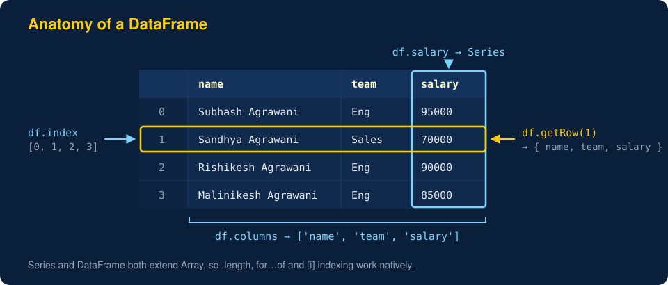
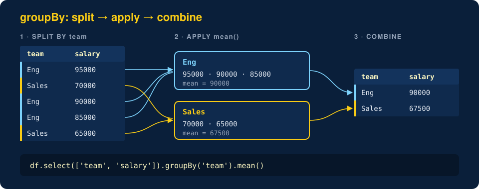
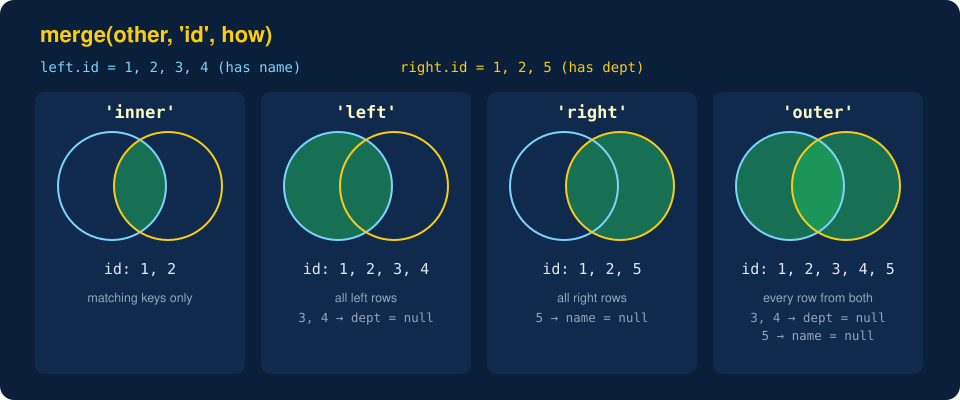

# DataFrame API

> Part of the [node-pandas](https://github.com/hygull/node-pandas/blob/master/README.md) docs · See also: [Series API](./series.md)

A `DataFrame` is a two-dimensional table: an `index` of row labels, a list of `columns`, and one row per entry. It extends `Array`, so `df.length`, `df[i]` and `for...of` work natively. Accessing a column by name (`df.salary`) returns a [Series](./series.md).



**Contents**

- [Creating a DataFrame](#creating-a-dataframe)
- [Writing to CSV](#writing-to-csv)
- [Accessing columns and rows](#accessing-columns-and-rows)
- [Selecting columns: select()](#selecting-columns-select)
- [Filtering rows: filter()](#filtering-rows-filter)
- [Grouping: groupBy()](#grouping-groupby)
- [Merging: merge()](#merging-merge)
- [Concatenating: concat()](#concatenating-concat)
- [Index manipulation](#index-manipulation)
- [Cell accessors: at and iat](#cell-accessors-at-and-iat)
- [Apply along an axis: apply()](#apply-along-an-axis-apply)

## Creating a DataFrame

### From a 2D array

```javascript
const pd = require("node-pandas")

const columns = ['full_name', 'user_id', 'technology']
const df = pd.DataFrame([
  ['Guido Van Rossum', 6, 'Python'],
  ['Ryan Dahl', 5, 'Node.js'],
  ['Anders Hejlsberg', 7, 'TypeScript'],
  ['Wes McKinney', 3, 'Pandas'],
  ['Ken Thompson', 1, 'B language']
], columns)

df.show
// ┌─────────┬────────────────────┬─────────┬──────────────┐
// │ (index) │     full_name      │ user_id │  technology  │
// ├─────────┼────────────────────┼─────────┼──────────────┤
// │    0    │ 'Guido Van Rossum' │    6    │   'Python'   │
// │    1    │    'Ryan Dahl'     │    5    │  'Node.js'   │
// │    2    │ 'Anders Hejlsberg' │    7    │ 'TypeScript' │
// │    3    │   'Wes McKinney'   │    3    │   'Pandas'   │
// │    4    │   'Ken Thompson'   │    1    │ 'B language' │
// └─────────┴────────────────────┴─────────┴──────────────┘

console.log(df.index)       // [ 0, 1, 2, 3, 4 ]
console.log(df.columns)     // [ 'full_name', 'user_id', 'technology' ]
```

### From a CSV file

**Signature:** `pd.readCsv(csvPath)` — `csvPath` is the absolute or relative path to the CSV file. Multiple blank lines between rows are tolerated and collapsed to a single newline.

Source CSV — [`devs.csv`](https://github.com/hygull/node-pandas/blob/master/docs/csvs/devs.csv):

```csv
fullName,Profession,Language,DevId
Ken Thompson,C developer,C,1122
Ron Wilson,Ruby developer,Ruby,4433
Jeff Thomas,Java developer,Java,8899

Rishikesh Agrawani,Python developer,Python,6677
Kylie Dwine,C++ developer,C++,2211

Briella Brown,JavaScript developer,JavaScript,8844
```

```javascript
const pd = require("node-pandas")

const df = pd.readCsv("./docs/csvs/devs.csv")

console.log(df.index)       // [ 0, 1, 2, 3, 4, 5 ]
console.log(df.columns)     // [ 'fullName', 'Profession', 'Language', 'DevId' ]

df.show
// ┌─────────┬──────────────────────┬────────────────────────┬──────────────┬───────┐
// │ (index) │       fullName       │       Profession       │   Language   │ DevId │
// ├─────────┼──────────────────────┼────────────────────────┼──────────────┼───────┤
// │    0    │    'Ken Thompson'    │     'C developer'      │     'C'      │ 1122  │
// │    1    │     'Ron Wilson'     │    'Ruby developer'    │    'Ruby'    │ 4433  │
// │    2    │    'Jeff Thomas'     │    'Java developer'    │    'Java'    │ 8899  │
// │    3    │ 'Rishikesh Agrawani' │   'Python developer'   │   'Python'   │ 6677  │
// │    4    │    'Kylie Dwine'     │    'C++ developer'     │    'C++'     │ 2211  │
// │    5    │   'Briella Brown'    │ 'JavaScript developer' │ 'JavaScript' │ 8844  │
// └─────────┴──────────────────────┴────────────────────────┴──────────────┴───────┘

// Cell access by row index + column name
console.log(df[0]['fullName']) // undefined
console.log(df[3]['Profession']) // undefined
console.log(df[5]['Language']) // undefined
```

## Writing to CSV

The `toCsv(path)` method writes the DataFrame to disk. The output path can be absolute or relative.

```javascript
const pd = require("node-pandas")

const df = pd.readCsv("./docs/csvs/devs.csv")

console.log(df.cols)        // 4
console.log(df.rows)        // 6
console.log(df.columns)     // [ 'fullName', 'Profession', 'Language', 'DevId' ]
console.log(df.index)       // [ 0, 1, 2, 3, 4, 5 ]

df.toCsv("./newDevs.csv")
// Writes the DataFrame to ./newDevs.csv
```

The resulting `newDevs.csv` (multiple blank lines from the source are collapsed):

```csv
fullName,Profession,Language,DevId
Ken Thompson,C developer,C,1122
Ron Wilson,Ruby developer,Ruby,4433
Jeff Thomas,Java developer,Java,8899
Rishikesh Agrawani,Python developer,Python,6677
Kylie Dwine,C++ developer,C++,2211
Briella Brown,JavaScript developer,JavaScript,8844
```

## Accessing columns and rows

> **CSV file** (devs.csv): [docs/csvs/devs.csv](https://github.com/hygull/node-pandas/blob/master/docs/csvs/devs.csv)

```javascript
const pd = require("node-pandas")
df = pd.readCsv("./docs/csvs/devs.csv") // Node DataFrame object

df.show
// ┌─────────┬──────────────────────┬────────────────────────┬──────────────┬───────┐
// │ (index) │       fullName       │       Profession       │   Language   │ DevId │
// ├─────────┼──────────────────────┼────────────────────────┼──────────────┼───────┤
// │    0    │    'Ken Thompson'    │     'C developer'      │     'C'      │ 1122  │
// │    1    │     'Ron Wilson'     │    'Ruby developer'    │    'Ruby'    │ 4433  │
// │    2    │    'Jeff Thomas'     │    'Java developer'    │    'Java'    │ 8899  │
// │    3    │ 'Rishikesh Agrawani' │   'Python developer'   │   'Python'   │ 6677  │
// │    4    │    'Kylie Dwine'     │    'C++ developer'     │    'C++'     │ 2211  │
// │    5    │   'Briella Brown'    │ 'JavaScript developer' │ 'JavaScript' │ 8844  │
// └─────────┴──────────────────────┴────────────────────────┴──────────────┴───────┘

console.log(df['fullName'])
// Series(6) [
//   'Ken Thompson',
//   'Ron Wilson',
//   'Jeff Thomas',
//   'Rishikesh Agrawani',
//   'Kylie Dwine',
//   'Briella Brown'
// ]

console.log(df.DevId)       // Series(6) [ 1122, 4433, 8899, 6677, 2211, 8844 ]

let languages = df.Language
console.log(languages)      // Series(6) [ 'C', 'Ruby', 'Java', 'Python', 'C++', 'JavaScript' ]

console.log(languages[0], '&', languages[1]) // C & Ruby

let professions = df.Profession
console.log(professions) 
// Series(6) [
//   'C developer',
//   'Ruby developer',
//   'Java developer',
//   'Python developer',
//   'C++ developer',
//   'JavaScript developer'
// ]

// Iterate like arrays
for(let profession of professions) {
    console.log(profession)
}
/*
    C developer
    Ruby developer
    Java developer
    Python developer
    C++
    JavaScript developer
*/
```

## Selecting columns: select()

The `select()` method returns a new DataFrame containing only the specified columns.

```javascript
const pd = require("node-pandas")

// Create a DataFrame with employee data
const df = pd.DataFrame([
    ['Rishikesh Agrawani', 32, 'Engineering'],
    ['Hemkesh Agrawani', 30, 'Marketing'],
    ['Malinikesh Agrawani', 28, 'Sales']
], ['name', 'age', 'department'])

df.show
// ┌─────────┬───────────────────────┬─────┬───────────────┐
// │ (index) │         name          │ age │  department   │
// ├─────────┼───────────────────────┼─────┼───────────────┤
// │    0    │ 'Rishikesh Agrawani'  │ 32  │ 'Engineering' │
// │    1    │  'Hemkesh Agrawani'   │ 30  │  'Marketing'  │
// │    2    │ 'Malinikesh Agrawani' │ 28  │    'Sales'    │
// └─────────┴───────────────────────┴─────┴───────────────┘

// Select a single column
const nameOnly = df.select(['name'])
nameOnly.show
// ┌─────────┬───────────────────────┐
// │ (index) │         name          │
// ├─────────┼───────────────────────┤
// │    0    │ 'Rishikesh Agrawani'  │
// │    1    │  'Hemkesh Agrawani'   │
// │    2    │ 'Malinikesh Agrawani' │
// └─────────┴───────────────────────┘

// Select multiple columns
const nameAndAge = df.select(['name', 'age'])
nameAndAge.show
// ┌─────────┬───────────────────────┬─────┐
// │ (index) │         name          │ age │
// ├─────────┼───────────────────────┼─────┤
// │    0    │ 'Rishikesh Agrawani'  │ 32  │
// │    1    │  'Hemkesh Agrawani'   │ 30  │
// │    2    │ 'Malinikesh Agrawani' │ 28  │
// └─────────┴───────────────────────┴─────┘

// Original DataFrame remains unchanged
console.log(df.columns)     // [ 'name', 'age', 'department' ]
```

## Filtering rows: filter()

The `filter()` method returns a new DataFrame containing only rows that match the condition. Multiple filters can be chained together.

```javascript
const pd = require("node-pandas")

// Create a DataFrame with employee data
const df = pd.DataFrame([
    ['Rishikesh Agrawani', 32, 'Engineering'],
    ['Hemkesh Agrawani', 30, 'Marketing'],
    ['Malinikesh Agrawani', 28, 'Sales']
], ['name', 'age', 'department'])

df.show
// ┌─────────┬───────────────────────┬─────┬───────────────┐
// │ (index) │         name          │ age │  department   │
// ├─────────┼───────────────────────┼─────┼───────────────┤
// │    0    │ 'Rishikesh Agrawani'  │ 32  │ 'Engineering' │
// │    1    │  'Hemkesh Agrawani'   │ 30  │  'Marketing'  │
// │    2    │ 'Malinikesh Agrawani' │ 28  │    'Sales'    │
// └─────────┴───────────────────────┴─────┴───────────────┘

// Filter rows where age is greater than 28
const over28 = df.filter(row => row.age > 28)
over28.show
// ┌─────────┬──────────────────────┬─────┬───────────────┐
// │ (index) │         name         │ age │  department   │
// ├─────────┼──────────────────────┼─────┼───────────────┤
// │    0    │ 'Rishikesh Agrawani' │ 32  │ 'Engineering' │
// │    1    │  'Hemkesh Agrawani'  │ 30  │  'Marketing'  │
// └─────────┴──────────────────────┴─────┴───────────────┘

// Filter rows where department is 'Engineering'
const engineering = df.filter(row => row.department === 'Engineering')
engineering.show
// ┌─────────┬──────────────────────┬─────┬───────────────┐
// │ (index) │         name         │ age │  department   │
// ├─────────┼──────────────────────┼─────┼───────────────┤
// │    0    │ 'Rishikesh Agrawani' │ 32  │ 'Engineering' │
// └─────────┴──────────────────────┴─────┴───────────────┘

// Chain multiple filters together
const result = df
    .filter(row => row.age > 28)
    .filter(row => row.department !== 'Sales')
result.show
// ┌─────────┬──────────────────────┬─────┬───────────────┐
// │ (index) │         name         │ age │  department   │
// ├─────────┼──────────────────────┼─────┼───────────────┤
// │    0    │ 'Rishikesh Agrawani' │ 32  │ 'Engineering' │
// │    1    │  'Hemkesh Agrawani'  │ 30  │  'Marketing'  │
// └─────────┴──────────────────────┴─────┴───────────────┘
```

## Grouping: groupBy()

`groupBy(column | columns)` returns a `GroupBy` object. Its aggregations (`mean()`, `sum()`, `min()`, `max()`, `std()`) are applied to **every numeric column**, so `select()` the columns you care about first. `count()` returns the number of rows per group.



```javascript
const pd = require("node-pandas")

const df = pd.DataFrame([
    ['Subhash Agrawani', 60, 'Engineering', 120000],
    ['Sandhya Agrawani', 55, 'Marketing', 95000],
    ['Rishikesh Agrawani', 32, 'Engineering', 95000],
    ['Hemkesh Agrawani', 30, 'Marketing', 75000],
    ['Malinikesh Agrawani', 28, 'Sales', 65000],
    ['Yagyavalkya Agrawani', 26, 'Engineering', 70000]
], ['name', 'age', 'department', 'salary'])

// Mean salary per department
df.select(['department', 'salary']).groupBy('department').mean().show
// ┌─────────┬───────────────┬────────┐
// │ (index) │  department   │ salary │
// ├─────────┼───────────────┼────────┤
// │    0    │ 'Engineering' │ 95000  │
// │    1    │  'Marketing'  │ 85000  │
// │    2    │    'Sales'    │ 65000  │
// └─────────┴───────────────┴────────┘

// Total salary per department
df.select(['department', 'salary']).groupBy('department').sum().show
// ┌─────────┬───────────────┬────────┐
// │ (index) │  department   │ salary │
// ├─────────┼───────────────┼────────┤
// │    0    │ 'Engineering' │ 285000 │
// │    1    │  'Marketing'  │ 170000 │
// │    2    │    'Sales'    │ 65000  │
// └─────────┴───────────────┴────────┘

// Youngest and oldest per department
df.select(['department', 'age']).groupBy('department').min().show
// ┌─────────┬───────────────┬─────┐
// │ (index) │  department   │ age │
// ├─────────┼───────────────┼─────┤
// │    0    │ 'Engineering' │ 26  │
// │    1    │  'Marketing'  │ 30  │
// │    2    │    'Sales'    │ 28  │
// └─────────┴───────────────┴─────┘
df.select(['department', 'age']).groupBy('department').max().show
// ┌─────────┬───────────────┬─────┐
// │ (index) │  department   │ age │
// ├─────────┼───────────────┼─────┤
// │    0    │ 'Engineering' │ 60  │
// │    1    │  'Marketing'  │ 55  │
// │    2    │    'Sales'    │ 28  │
// └─────────┴───────────────┴─────┘

// Head count per department
df.groupBy('department').count().show
// ┌─────────┬───────────────┬───────┐
// │ (index) │  department   │ count │
// ├─────────┼───────────────┼───────┤
// │    0    │ 'Engineering' │   3   │
// │    1    │  'Marketing'  │   2   │
// │    2    │    'Sales'    │   1   │
// └─────────┴───────────────┴───────┘

// Group by several columns
df.groupBy(['department', 'age']).count().show
// ┌─────────┬───────────────┬──────┬───────┐
// │ (index) │  department   │ age  │ count │
// ├─────────┼───────────────┼──────┼───────┤
// │    0    │ 'Engineering' │ '26' │   1   │
// │    1    │ 'Engineering' │ '32' │   1   │
// │    2    │ 'Engineering' │ '60' │   1   │
// │    3    │  'Marketing'  │ '30' │   1   │
// │    4    │  'Marketing'  │ '55' │   1   │
// │    5    │    'Sales'    │ '28' │   1   │
// └─────────┴───────────────┴──────┴───────┘
```

## Merging: merge()

`merge(other, on, how = 'inner', suffixes = ['_x', '_y'])` joins two DataFrames on one key column (or an array of key columns). Columns that exist on both sides get the suffixes. Unmatched cells are filled with `null`.



```javascript
const pd = require("node-pandas")

const people = pd.DataFrame([
    [1, 'Rishikesh Agrawani'],
    [2, 'Hemkesh Agrawani'],
    [3, 'Malinikesh Agrawani'],
    [4, 'Sandhya Agrawani']
], ['id', 'name'])

const depts = pd.DataFrame([
    [1, 'Engineering'],
    [2, 'Sales'],
    [5, 'Operations']
], ['id', 'dept'])

// inner: only ids present on both sides
people.merge(depts, 'id', 'inner').show
// ┌─────────┬────┬──────────────────────┬───────────────┐
// │ (index) │ id │         name         │     dept      │
// ├─────────┼────┼──────────────────────┼───────────────┤
// │    0    │ 1  │ 'Rishikesh Agrawani' │ 'Engineering' │
// │    1    │ 2  │  'Hemkesh Agrawani'  │    'Sales'    │
// └─────────┴────┴──────────────────────┴───────────────┘

// left: every row of people
people.merge(depts, 'id', 'left').show
// ┌─────────┬────┬───────────────────────┬───────────────┐
// │ (index) │ id │         name          │     dept      │
// ├─────────┼────┼───────────────────────┼───────────────┤
// │    0    │ 1  │ 'Rishikesh Agrawani'  │ 'Engineering' │
// │    1    │ 2  │  'Hemkesh Agrawani'   │    'Sales'    │
// │    2    │ 3  │ 'Malinikesh Agrawani' │     null      │
// │    3    │ 4  │  'Sandhya Agrawani'   │     null      │
// └─────────┴────┴───────────────────────┴───────────────┘

// right: every row of depts
people.merge(depts, 'id', 'right').show
// ┌─────────┬────┬──────────────────────┬───────────────┐
// │ (index) │ id │         name         │     dept      │
// ├─────────┼────┼──────────────────────┼───────────────┤
// │    0    │ 1  │ 'Rishikesh Agrawani' │ 'Engineering' │
// │    1    │ 2  │  'Hemkesh Agrawani'  │    'Sales'    │
// │    2    │ 5  │         null         │ 'Operations'  │
// └─────────┴────┴──────────────────────┴───────────────┘

// outer: every row of both
people.merge(depts, 'id', 'outer').show
// ┌─────────┬────┬───────────────────────┬───────────────┐
// │ (index) │ id │         name          │     dept      │
// ├─────────┼────┼───────────────────────┼───────────────┤
// │    0    │ 1  │ 'Rishikesh Agrawani'  │ 'Engineering' │
// │    1    │ 2  │  'Hemkesh Agrawani'   │    'Sales'    │
// │    2    │ 3  │ 'Malinikesh Agrawani' │     null      │
// │    3    │ 4  │  'Sandhya Agrawani'   │     null      │
// │    4    │ 5  │         null          │ 'Operations'  │
// └─────────┴────┴───────────────────────┴───────────────┘
```

## Concatenating: concat()

The `concat()` method stacks DataFrames vertically (axis=0) or horizontally (axis=1).

```javascript
const pd = require("node-pandas")

// Create DataFrames to concatenate
const df1 = pd.DataFrame([
    [1, 'Rishikesh Agrawani'],
    [2, 'Hemkesh Agrawani']
], ['id', 'name'])

const df2 = pd.DataFrame([
    [3, 'Malinikesh Agrawani']
], ['id', 'name'])

// Vertical concatenation (stack rows)
const verticalConcat = pd.DataFrame.concat([df1, df2], 0)
verticalConcat.show
// ┌─────────┬────┬───────────────────────┐
// │ (index) │ id │         name          │
// ├─────────┼────┼───────────────────────┤
// │    0    │ 1  │ 'Rishikesh Agrawani'  │
// │    1    │ 2  │  'Hemkesh Agrawani'   │
// │    2    │ 3  │ 'Malinikesh Agrawani' │
// └─────────┴────┴───────────────────────┘

// Horizontal concatenation (stack columns)
const df3 = pd.DataFrame([
    [25, 'Engineering'],
    [30, 'Marketing']
], ['age', 'department'])

const horizontalConcat = pd.DataFrame.concat([df1, df3], 1)
horizontalConcat.show
// ┌─────────┬────┬──────────────────────┬─────┬───────────────┐
// │ (index) │ id │         name         │ age │  department   │
// ├─────────┼────┼──────────────────────┼─────┼───────────────┤
// │    0    │ 1  │ 'Rishikesh Agrawani' │ 25  │ 'Engineering' │
// │    1    │ 2  │  'Hemkesh Agrawani'  │ 30  │  'Marketing'  │
// └─────────┴────┴──────────────────────┴─────┴───────────────┘
```

## Index manipulation

### setIndex()

Promote a column to be the DataFrame's row index. Returns a **new** DataFrame; the original is unchanged.

```javascript
const pd = require("node-pandas")

const df = pd.DataFrame(
  [[1, 'Malinikesh Agrawani', 28], [2, 'Hemkesh Agrawani', 30], [3, 'Rishikesh Agrawani', 32]],
  ['id', 'name', 'age']
)

// Promote 'id' to index (default: drop the column)
const indexed = df.setIndex('id')
console.log(indexed.index)  // [ 1, 2, 3 ]
console.log(indexed.columns) // [ 'name', 'age' ]

// Keep the column as a regular column too
const kept = df.setIndex('id', { drop: false })
console.log(kept.columns)   // [ 'id', 'name', 'age' ]

// Errors:
//   df.setIndex('missing')   // throws ColumnError
//   df.setIndex(42)          // throws ValidationError
```

### resetIndex()

Demote the current index back to a regular column, or discard it. Returns a **new** DataFrame.

```javascript
const pd = require("node-pandas")

const df = pd.DataFrame([[28, 'Malinikesh Agrawani'], [30, 'Hemkesh Agrawani']], ['age', 'name'])
df.index = ['a', 'b']

// Default: promote index to a column named 'index', reset index to 0..n-1
const a = df.resetIndex()
console.log(a.columns)      // [ 'index', 'age', 'name' ]
console.log(a.getRow(0))    // { index: 'a', age: 28, name: 'Malinikesh Agrawani' }

// Custom column name
const b = df.resetIndex({ name: 'label' })
console.log(b.columns)      // [ 'label', 'age', 'name' ]

// Discard the index entirely
const c = df.resetIndex({ drop: true })
console.log(c.columns)      // [ 'age', 'name' ]
console.log(c.index)        // [ 0, 1 ]
```

## Cell accessors: at and iat

### at.get() / at.set()

Fast scalar label-based cell accessor. Accepts a single row label and a single column name.

```javascript
const pd = require("node-pandas")

const df = pd.DataFrame([[1, 'Malinikesh Agrawani', 28], [2, 'Hemkesh Agrawani', 30]], ['id', 'name', 'age'])
df.index = ['x', 'y']

// Get a single cell
console.log(df.at.get('x', 'name')) // Malinikesh Agrawani

// Set a single cell (mutates in place, returns the DataFrame)
df.at.set('x', 'name', 'Malini Agrawani')
console.log(df.at.get('x', 'name')) // Malini Agrawani

// Errors:
//   df.at.get('z', 'name')         // throws IndexError (row label not found)
//   df.at.get('x', 'missing')      // throws ColumnError
//   df.at.get(['x'], 'name')       // throws ValidationError (arrays not allowed)
```

### iat.get() / iat.set()

Fast scalar position-based cell accessor. Accepts a row position and column position.

```javascript
const pd = require("node-pandas")

const df = pd.DataFrame([[1, 'Malinikesh Agrawani', 28], [2, 'Hemkesh Agrawani', 30]], ['id', 'name', 'age'])

// Get cell at (row 0, column 1)
console.log(df.iat.get(0, 1)) // Malinikesh Agrawani

// Set cell (mutates, returns DataFrame)
df.iat.set(0, 1, 'Malini Agrawani')
console.log(df.iat.get(0, 1)) // Malini Agrawani

// Errors:
//   df.iat.get(99, 0)        // throws IndexError (row out of range)
//   df.iat.get(0, 9)         // throws IndexError (column out of range)
//   df.iat.get(0.5, 0)       // throws ValidationError (must be integer)
```

## Apply along an axis: apply()

### apply(fn, { axis })

Apply a function along an axis. The callback receives a real `Series` (with `_index` and `_name`), so you can compose with any Series method inside `fn`.

```javascript
const pd = require("node-pandas")

const df = pd.DataFrame(
  [[1, 10, 100], [2, 20, 200], [3, 30, 300]],
  ['a', 'b', 'c']
)

// axis: 0 (default) — apply per column, fn receives a Series per column
const colSums = df.apply(col => col._data.reduce((s, v) => s + v, 0))
console.log(colSums._data)  // [ 6, 60, 600 ]
console.log(colSums._index) // [ 'a', 'b', 'c' ]

// axis: 1 — apply per row, fn receives a Series per row
const rowSums = df.apply(row => row._data.reduce((s, v) => s + v, 0), { axis: 1 })
console.log(rowSums._data)  // [ 111, 222, 333 ]

// Returning arrays produces a DataFrame, with column names preserved on axis 0
const firstAndLast = df.apply(col => [col._data[0], col._data[col._data.length - 1]])
console.log(firstAndLast.columns) // [ 'a', 'b', 'c' ]
console.log(firstAndLast.getRow(0)) // { a: 1, b: 10, c: 100 }

// Errors:
//   df.apply(null)                // throws ValidationError (fn must be a function)
//   df.apply(x => x, { axis: 2 }) // throws ValidationError (axis must be 0 or 1)
//   df.apply(() => i++ === 0 ? 1 : [1, 2])  // throws OperationError (mixed return shapes)
```

The legacy column-transform form `df.apply('columnName', fn)` — where `fn` transforms each cell of a single column — is still supported. The dispatcher routes by the type of the first argument: string → legacy column transform; function → axis-based apply.
